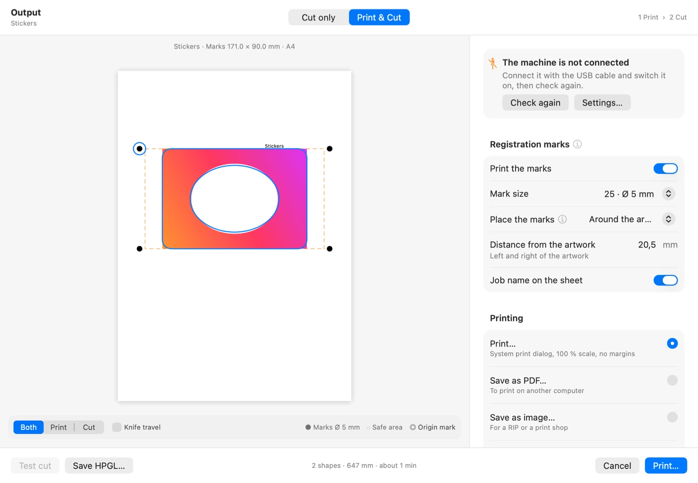
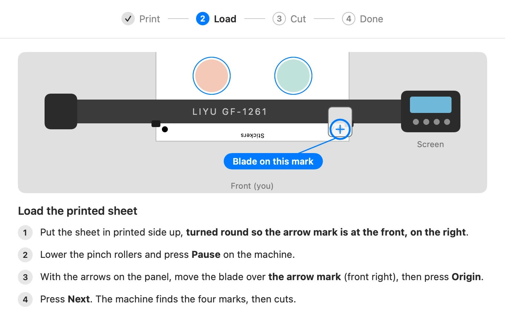

## Primeiros passos

### Instalar

Descarregue `Recorte-<versão>.zip` da [versão mais recente](https://github.com/cookiebytespt/Recorte/releases/latest),
descomprima-o e mova o **Recorte.app** para a pasta Aplicações. A app ainda não está notarizada, por isso da
primeira vez **clique-lhe com o botão direito ▸ Abrir** (ou execute `xattr -dr com.apple.quarantine /Applications/Recorte.app`).

A janela **Primeiros passos** abre no primeiro arranque com os quatro passos abaixo.

### Ligar a máquina

A GF-1261 liga-se por USB ("LIYU CUTTING PLOTTER"). Não é preciso driver nem configurar impressoras.

1. Ligue a máquina com o cabo USB e ligue-a no interruptor.
2. Prima **⌘P**. O Recorte encontra a máquina sozinho e o estado na janela Saída fica
   verde: **Pronta**. **Definições ▸ Máquina** mostra a máquina encontrada.

O Recorte só envia para o ID USB da própria Liyu, por isso um trabalho nunca vai parar a uma impressora por engano.

### Fazer um corte de teste

Com um material ou uma lâmina novos, prima **Corte de teste** na janela Saída: corta um pequeno quadrado
com um círculo dentro. A lâmina deve cortar o vinil e apenas riscar o suporte.
Se não for assim, veja [Velocidade, pressão e lâmina](#speed-pressure-and-blade).

## Desenhar e importar

O Recorte abre numa tela vazia (300 × 200 mm por omissão; altere-a, ou escolha um tamanho de papel,
na barra lateral). Escolha uma ferramenta na barra de ferramentas e arraste na tela.

| Ferramenta | Tecla | Como |
|---|---|---|
| Selecionar | V | clique para selecionar, arraste para mover, ⇧-clique para acrescentar, pegas para redimensionar; duplo clique nas linhas para editar os pontos |
| Mover vista | H | arraste para se mover; junte os dedos ou use os botões de zoom para aproximar |
| Retângulo, Elipse | R, E | arraste para desenhar, clique para uma forma de 40 mm, ⇧ mantém-na quadrada / redonda |
| Linha, Polígono, Estrela | L, G, S | arraste para desenhar; lados, pontas e raio dos cantos na barra lateral |
| Mão livre | P | arraste para desenhar; ative *Forma fechada* na barra lateral para recortar uma peça |
| Texto | T | clique para colocar; texto, tipo de letra e tamanho na barra lateral. Convertido em contornos ao cortar |

A barra lateral mostra as definições da tela, ou a posição, o tamanho, a rotação e as opções do
objeto selecionado. Na lista **Camadas** pode ocultar objetos (os objetos ocultos não são impressos nem
cortados) e bloqueá-los (os objetos bloqueados não podem ser movidos nem eliminados, mas são cortados).

### Abrir ficheiros

**Ficheiro ▸ Importar desenho… (⇧⌘I)** acrescenta um ficheiro como linhas de corte. Também pode abrir
estes ficheiros diretamente como um projeto novo.

| Formato | Notas |
|---|---|
| `.ai` | Tem de ser guardado com *Create PDF Compatible File* (a opção por omissão do Illustrator). Só a primeira prancheta. |
| `.pdf` | Primeira página. |
| `.svg` | Os tamanhos sem unidades são lidos a 72 por polegada (Illustrator); mude para 96 em **Definições ▸ Ficheiros** se um ficheiro entrar com o tamanho errado. |
| `.dxf` | LINE, (LW)POLYLINE com bulges, CIRCLE, ARC, ELLIPSE, SPLINE. |

O texto dos ficheiros importados tem de ser convertido em contornos primeiro (no Illustrator: *Texto ▸ Criar
contornos*); o Recorte avisa quando ignora texto. As máscaras de recorte e as imagens são ignoradas ao
importar linhas de corte. Para imprimir uma imagem, use **Colocar arte…** ([Imprimir e Cortar](#print--cut)).

### Editar linhas

Selecione um desenho importado ou um contorno de corte para ver a secção **Linhas** na barra lateral:

- **Editar pontos** (ou duplo clique no objeto, ou a tecla ↩): arraste pontos, pegas ou linhas
  inteiras; ⌥-clique numa linha para acrescentar um ponto; ⌥-arraste um ponto para puxar as pegas da curva;
  duplo clique num ponto para alternar entre suave e canto; ⌫ elimina. ↩ ou Esc termina a edição.
- **Manter só as linhas exteriores** remove as linhas que estão dentro de outras (por exemplo, os buracos de um contorno).
- **Separar em objetos individuais** faz de cada linha um objeto próprio.
- **Suavizar em curvas** substitui muitos segmentos pequenos por menos curvas suaves.
- **Deslocamento** aumenta (positivo) ou encolhe (negativo) as linhas fechadas a uma dada distância, com cantos redondos.

## Cortar vinil (Só cortar)

1. Prima **Cortar…** na barra de ferramentas ou **⌘P**. A janela **Saída** abre com **Só cortar** selecionado.
2. À esquerda, a pré-visualização mostra o vinil visto de cima, consigo à frente, com a largura
   de corte da máquina e o ponto de início na **frente, à direita** (o lado da lâmina,
   junto ao ecrã da máquina). Visto de frente, o desenho sai de pernas para o ar; não fica
   espelhado.
3. Verifique as definições à direita:
   - **Tamanho e posição:** tamanho, escala, *Rodar 90°*, *Espelhar* (para vinil têxtil termocolante,
     que é cortado pelo verso), **Da direita** e **Do início** (distância do ponto de início
     ao desenho) e **Avançar o vinil depois de cortar** (faz avançar o vinil para lá do
     desenho, para ser fácil cortá-lo; desligado, a lâmina volta ao início).
   - **Corte:** material e [velocidade, pressão e lâmina](#speed-pressure-and-blade).
   - **Cortar:** número de cópias (cortadas umas a seguir às outras ao longo do vinil) e *Toda a tela* ou
     *Só a seleção*.
4. Prima **Cortar…**. O Recorte mostra como carregar o vinil:
   1. Coloque o vinil com a margem da frente logo a seguir à lâmina e baixe os roletes de pressão.
   2. Leve a lâmina até ao canto da frente, à direita, do vinil, onde o corte começa.
   3. Prima **Origin** na máquina.
   4. Prima **Cortar**.
5. Quando terminar, escolha **Cortar de novo** para outra cópia ou **Concluído**.

<figure><figcaption>A janela Saída (aqui em modo Imprimir e Cortar, com a interface em inglês).</figcaption></figure>

**Guardar HPGL…** guarda o trabalho num ficheiro, para outro software de corte ou para o suporte; não
precisa dele para cortar.

## Imprimir e Cortar

Imprima a sua arte com quatro marcas de registo em qualquer impressora; a câmara da máquina encontra
as marcas e corta à volta da impressão.

### 1. Preparar a folha

1. Ative **Imprimir e Cortar** na barra lateral da tela. A tela passa a ser a folha impressa: defina-a
   com o tamanho do seu papel (menu **Tamanho da página**).
2. **Colocar arte… (⌥⌘I)** acrescenta um ficheiro PDF, Illustrator, PNG ou JPEG para imprimir. A arte
   colocada é impressa, nunca cortada.
3. Faça as linhas de corte:
   - **Criar contorno de corte… (⇧⌘K)** traça-as por si (abaixo), ou
   - desenhe-as ou importe-as por cima da arte.

Mantenha tudo dentro da área segura a tracejado. Por omissão, as marcas ficam **à volta da arte**,
20,5 mm à esquerda e à direita, como no SignMaster; em alternativa, pode pô-las **nas margens da página**.
As marcas ficam vermelhas na tela quando saem da página.

### 2. Criar contorno de corte

Selecione as imagens colocadas (ou nenhuma, para todas) e escolha **Objeto ▸ Criar contorno de corte…**.

- **Forma:** *Seguir a arte* traça o contorno; *Retângulo* ou *Arredondado* põem uma caixa à volta de cada imagem.
- **Distância à arte:** 2 mm por omissão. Uma pequena folga esconde pequenas diferenças entre
  a impressão e o corte.
- **Cantos** arredondados ou vivos, **Cortar os buracos** (zonas transparentes dentro da imagem), **Curvas suaves**.
- **Contorno da imagem:** *Transparência* (PNG, PDF, AI), *Fundo branco* (JPEG) ou
  *Escolher cor* (clique no fundo na pré-visualização, como o Alfa instantâneo na Pré-visualização do Mac).
- **Ignorar pontos menores que** 1 mm.

**Criar contorno** acrescenta um objeto "Contorno de corte" editável por imagem. Com *Substituir contornos
de corte existentes* ativo, os contornos antigos das mesmas imagens são removidos para não serem cortados duas vezes.

### 3. Imprimir

Prima **Imprimir e Cortar…** ou **⌘P**. Na janela Saída:

- **Marcas de registo:** o *Tamanho da marca* tem de ser igual ao definido na máquina (25 = círculos de Ø 5 mm),
  *Colocar as marcas*, a distância ou as margens da página, e o nome do trabalho por cima das marcas.
- **Impressão:** *Imprimir…* (a **100 % e sem margens**, ou as marcas não vão alinhar),
  *Guardar como PDF…*, *Guardar como imagem…* (PNG ou TIFF, 150 / 300 / 600 dpi) ou *Não imprimir* se a
  folha já estiver impressa.
- A pré-visualização mostra a folha com as marcas, a área segura e a marca de origem (com um anel);
  alterne entre *Ambos*, *Impressão* e *Cortar*.

### 4. Carregar a folha e cortar

Depois de imprimir, o Recorte mostra como carregar a folha:

1. Coloque a folha com o lado impresso para cima, **rodada de modo a que a marca da seta fique à frente,
   à direita**.
2. Baixe os roletes de pressão e prima **Pause** na máquina.
3. Com as setas do painel, leve a lâmina para cima da **marca da seta** e prima **Origin**.
4. Prima **Seguinte**. A máquina visita as quatro marcas e depois corta sozinha.

<figure><figcaption>O assistente mostra onde fica a folha e onde colocar a lâmina (interface em inglês).</figcaption></figure>

A seguir, diga ao Recorte como correu: **Corte concluído**, ou **Marcas não encontradas** para ver uma lista
de verificação e **Tentar de novo** com a mesma folha (não é preciso reimprimir). Com várias cópias, o Recorte
pede cada folha impressa à vez.

## Velocidade, pressão e lâmina

Abra **Velocidade, pressão e lâmina** na janela Saída.

- **Material** define uma velocidade e uma pressão iniciais. São pontos de partida: confirme com um corte de teste.

  | Material | Velocidade | Pressão |
  |---|---|---|
  | Vinil normal | 300 mm/s | 80 g |
  | Vinil espesso | 200 mm/s | 120 g |
  | Vinil têxtil (termocolante) | 250 mm/s | 90 g |
  | Flock | 150 mm/s | 150 g |
  | Cartolina | 150 mm/s | 140 g |
  | Vinil refletor | 150 mm/s | 160 g |

- **Enviar velocidade e pressão para a máquina** está **desligado** por omissão: a máquina usa então a
  velocidade e a pressão definidas no seu próprio painel. Ligue-o para enviar os valores do Recorte com cada
  trabalho (no SignMaster, *Cutting Speed / Cutting Force* assinalados). O valor por omissão pode ser alterado em
  **Definições ▸ Máquina**.
- **Desvio da lâmina** (0,25 mm por omissão): a ponta de uma lâmina de arrasto segue atrás do centro do
  suporte, por isso o Recorte acrescenta um pequeno laço em cada canto para manter os cantos vivos. Cantos
  arredondados significam que o desvio é demasiado pequeno; marcas a mais nos cantos significam que é demasiado grande.
- **Sobrecorte** (1 mm): a lâmina continua para lá do início de uma forma fechada, para as pontas se encontrarem.
- **Cortar primeiro as formas interiores** evita que as peças pequenas se mexam; **Percurso mais curto da lâmina**
  reordena as formas para poupar tempo.

Pressão a menos deixa o vinil por cortar; pressão a mais corta o suporte. Mude uma coisa de cada
vez e faça um corte de teste depois de cada alteração.

## Resolução de problemas

| Problema | O que fazer |
|---|---|
| **A máquina não está ligada** | Verifique o cabo USB e se a máquina está ligada, e depois **Verificar de novo**. |
| **A máquina está ligada mas não responde** | Desligue-a e volte a ligá-la. Se continuar sem responder, ative **Definições ▸ Máquina ▸ Resolução de problemas**, abra **Ajuda ▸ Diagnóstico da máquina…**, prima **Full check (safe)** e envie o registo (**Show log file**) ao suporte. |
| **A máquina não encontrou as marcas** | Nada foi cortado. Verifique se a folha está direita, com o lado impresso para cima e a marca da seta à frente, à direita; se a lâmina estava sobre a marca da seta quando premiu Origin; se as marcas estão a preto sólido e não estão debaixo de um rolete de pressão nem de fita-cola; e se a folha foi impressa a 100 % com o mesmo tamanho de marca da máquina. Depois, **Tentar de novo** com a mesma folha. Reimprima só se as marcas estiverem danificadas. |
| **As marcas não cabem na página** | Afaste a arte das margens, use uma página maior ou uma distância à arte menor. |
| **As linhas de corte têm de ficar dentro das marcas** | Mova as formas que atravessam as marcas, ou coloque as marcas à volta da arte. |
| **Demasiado largo para a máquina** | Reduza o desenho, rode-o 90° ou diminua *Da direita*. |
| **O vinil não fica cortado / o suporte fica cortado** | Ajuste a pressão (na máquina, ou com *Enviar velocidade e pressão* ligado) e faça um corte de teste. |
| **Os cantos ficam arredondados ou com marcas a mais** | Ajuste o desvio da lâmina e faça um corte de teste. |
| **Um SVG entra com o tamanho errado** | **Definições ▸ Ficheiros ▸ Tamanho de ficheiros SVG sem unidades**: experimente a outra opção. |
| **O texto foi ignorado ao importar** | Converta-o primeiro em contornos na sua app de desenho (Illustrator: *Texto ▸ Criar contornos*), ou escreva o texto no Recorte. |

Para comunicar um problema, use **Ajuda ▸ Comunicar um problema…** ou [abra uma issue](https://github.com/cookiebytespt/Recorte/issues/new).

## Para quem vem do SignMaster

O Recorte segue os mesmos passos do SignMaster com esta máquina, com nomes mais simples. As dicas de
ajuda na app indicam também o nome no SignMaster.

| SignMaster | Recorte |
|---|---|
| Create Cut Contour (Build Contours / Build Boxes) | Criar contorno de corte (*Seguir a arte* / *Retângulo*, *Arredondado*) |
| Outline offset · Keep Holes | Distância à arte · Cortar os buracos |
| Contour Cut Wizard (Contour cut / ARMS) | Janela Saída em modo **Imprimir e Cortar**, e depois o assistente de corte |
| Mark Position (20.5 mm) | Distância à arte (marcas *À volta da arte*) |
| Print Direct / Save PDF / Save as Image / Skip | Imprimir… / Guardar como PDF… / Guardar como imagem… / Não imprimir |
| View both / Print only / Cut only | Pré-visualização: Ambos / Impressão / Cortar |
| Job Name | Nome do trabalho na folha |
| Send to be Cut | Janela Saída em modo **Só cortar** |
| Advance After Plot | Avançar o vinil depois de cortar |
| Cutting Speed / Cutting Force (assinalados) | Enviar velocidade e pressão para a máquina |
| Cut Insides First | Cortar primeiro as formas interiores |

## Atalhos de teclado

| Teclas | Ação |
|---|---|
| V H R E L G S P T | Ferramentas: Selecionar, Mover vista, Retângulo, Elipse, Linha, Polígono, Estrela, Mão livre, Texto |
| ⇧ ao desenhar | Manter as proporções |
| Esc | Voltar à ferramenta Selecionar / parar de editar pontos |
| ⌘D · ⌫ | Duplicar · Eliminar |
| ← → ↑ ↓ | Mover a seleção 1 mm |
| ⌘] · ⌘[ | Trazer para a frente · Enviar para trás |
| ⇧⌘A | Selecionar todos os objetos |
| ⌘Z · ⇧⌘Z | Desfazer · Refazer |
| ↩ | Editar os pontos das linhas selecionadas (↩ outra vez para terminar) |
| ⇧⌘I · ⌥⌘I | Importar desenho… · Colocar arte… |
| ⇧⌘K | Criar contorno de corte… |
| ⌘P | Cortar… / Imprimir e Cortar… |
| ⌘? | Ajuda do Recorte (esta página) |
